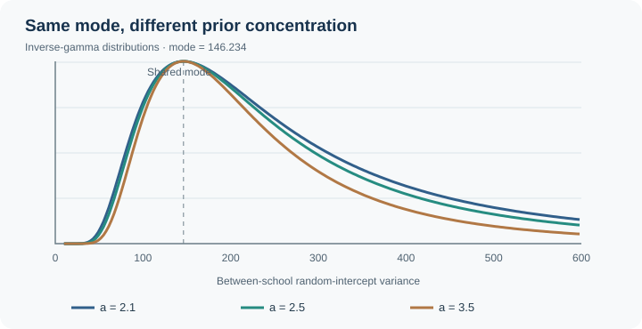
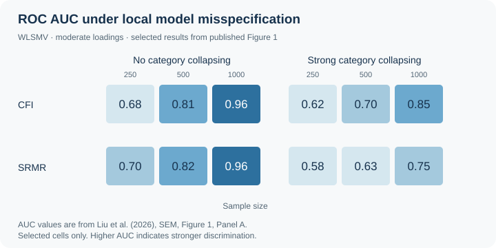

::: {.hero-shell}
::: {.hero-copy}

QUANTITATIVE METHODOLOGY · MEASUREMENT · EDUCATIONAL STATISTICS

# Liu Liu, Ph.D.

Quantitative Methodologist

I develop **Bayesian and psychometric methods** for reliable inference when data are limited or complex. My research is motivated by practical challenges in educational measurement, longitudinal analysis, and social research.

I am an Assistant Research Scientist at the University of Georgia and earned my Ph.D. in Measurement and Statistics from the University of Washington.

:::

::: {.hero-photo}
{fig-alt="Professional headshot of Liu Liu"}

<strong>University of Georgia</strong> 
Assistant Research Scientist 
<a href="https://ssw.uga.edu/team_member/liu-liu/" target="_blank" rel="noopener noreferrer">School of Social Work</a> / <a href="https://cenhtro.uga.edu/" target="_blank" rel="noopener noreferrer">CenHTRO</a> 
Faculty Affiliate · <a href="https://oibr.uga.edu/" target="_blank" rel="noopener noreferrer">Owens Institute for Behavioral Research</a> 
<a class="photo-email" href="mailto:liuuil@uga.edu">liuuil@uga.edu</a>

<a href="https://scholar.google.com/citations?user=nzeJHtIAAAAJ&amp;hl=en" target="_blank" rel="noopener noreferrer">Google Scholar ↗</a>
<a href="https://orcid.org/0000-0001-6900-9829" target="_blank" rel="noopener noreferrer">iD ORCID ↗</a>

:::
:::

::: {.home-section .visual-areas}

RESEARCH FOCUS

## Methods development informed by applied research

<a class="visual-area-card" href="research.html#bayesian-multilevel-and-longitudinal-methods">∿<strong>Bayesian Methods</strong><small>Variance priors · multilevel and longitudinal models · small-sample inference</small></a>
<a class="visual-area-card" href="research.html#measurement-psychometrics-and-sem">◉<strong>Psychometrics</strong><small>Ordinal CFA · SEM · IRT · measurement fairness</small></a>
<a class="visual-area-card" href="research.html#applied-research">▤<strong>Applied Research</strong><small>Educational assessment · program evaluation · social research</small></a>

:::

::: {.home-section .research-program-section}

RESEARCH PROGRAM

## How applied research shapes my methods work

<strong>Applied research problems</strong><small>Small samples · sparse responses · complex designs</small>

↓

<strong>Bayesian modeling</strong><small>Priors · multilevel · longitudinal</small>

<strong>Psychometrics</strong><small>CFA · SEM · IRT · fit evaluation</small>

↓

<strong>Practical statistical guidance</strong><small>Reliable estimation · defensible measurement decisions · reproducible tools</small>

[Explore the research program →](research.qmd){.text-link}
:::

::: {.home-section .selected-work .compact-work .home-featured-work}

SELECTED RESEARCH

## Methods and selected applications

<article class="home-feature-card">

BAYESIAN METHODS · MBR · 2026

<h3><a href="https://doi.org/10.1080/00273171.2026.2740827">Mode-matched inverse-gamma priors for variance components in Bayesian multilevel models</a></h3>

Calibrating variance priors for reliable multilevel estimation with limited higher-level samples.

<a href="projects/bayesian-variance-priors.qmd">Research project</a><a href="https://doi.org/10.1080/00273171.2026.2740827">Published paper</a>

</article>
<article class="home-feature-card">

PSYCHOMETRICS · SEM · 2026

<h3><a href="https://doi.org/10.1080/10705511.2026.2691170">Simulation-cum-ROC fit evaluation in sparse ordinal CFA under category collapsing</a></h3>

Examining how sparse categories and category collapsing affect the detection of CFA model misspecification.

<a href="projects/sparse-ordinal-cfa.qmd">Research project</a><a href="https://doi.org/10.1080/10705511.2026.2691170">Published paper</a>

</article>

ADDITIONAL SELECTED WORK

LONGITUDINAL METHODS · 2026<a href="https://doi.org/10.1016/j.metip.2026.100281">Longitudinal dyadic modeling with limited numbers of dyads</a>
<em>Methods in Psychology</em>

APPLIED EDUCATION · 2026<a href="https://doi.org/10.1186/s40536-026-00320-y">Explainable AI for predicting and interpreting mathematics achievement</a>
<em>Large-scale Assessments in Education</em>

[Explore projects →](projects/index.qmd){.text-link}
[View all publications →](publications.qmd){.text-link}

:::
