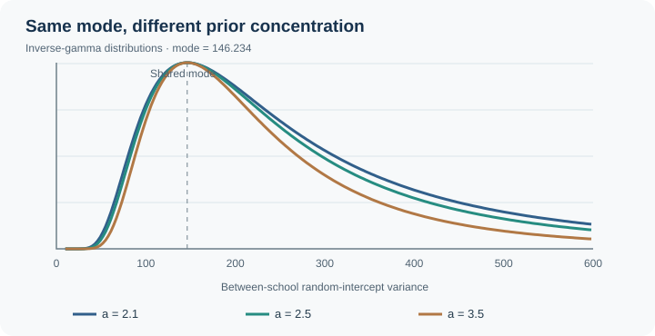
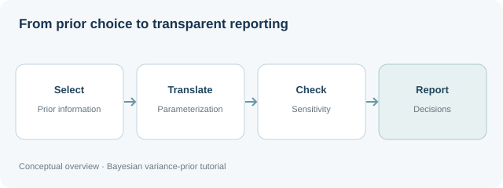
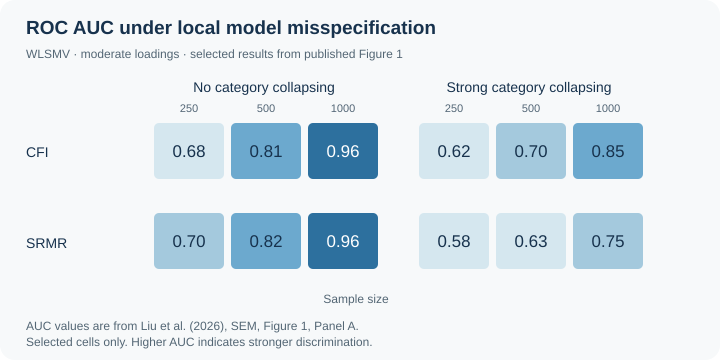
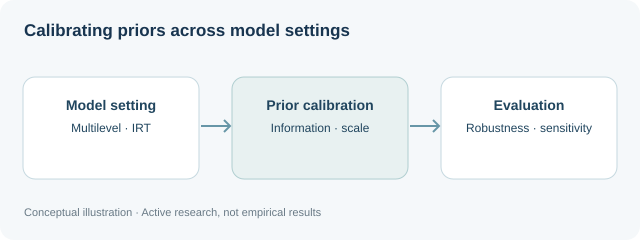

::: {.projects-lede}
My research is **methods-first and applications-grounded**. Methodological programs form the core of my work, while applied studies in education and social research generate substantive questions, difficult data structures, and recurring problems that motivate new quantitative research.
:::

  
∿Bayesian methods &amp; prior calibrationVariance priors, specification, and calibrationPROJECTS 01 · 02 · 04

  
◉Psychometrics &amp; measurementSparse ordinal data and model-fit decisionsPROJECT 03

  
▤Longitudinal &amp; dyadic methodsMultilevel modeling with limited informationPROJECT 05

Applied work in education and social research helps identify methodological challenges and provides settings for evaluating practical statistical decisions.

::: {.project-section-heading}

METHODOLOGICAL RESEARCH PROGRAMS

## Developing and evaluating quantitative methods
:::

::: {.project-grid}
::: {.project-card}

01

Published-parameter reconstruction

BAYESIAN METHODS · PUBLISHED

## Variance priors for Bayesian multilevel models

Informative prior specification for variance components when higher-level sample sizes are limited, including simulation-based evaluation and practical calibration guidance.

Multivariate Behavioral Research · Sole-authored

[View project →](bayesian-variance-priors.qmd){.project-link}
:::

::: {.project-card}

02

Conceptual workflow

BAYESIAN PRACTICE · PUBLISHED

## Selecting, translating, and reporting variance priors

A practical framework for choosing variance priors, translating them across parameterizations and software, conducting sensitivity analyses, and reporting prior decisions transparently.

Behavior Research Methods · Sole-authored

[View project →](bayesian-prior-guidance.qmd){.project-link}
:::

::: {.project-card}

03

Published ROC AUC results

PSYCHOMETRICS · PUBLISHED

## Sparse ordinal CFA and model-fit decisions

How sparse response categories and category collapsing change fit-index behavior, model-fit decisions, and the calibration of practical decision rules.

Structural Equation Modeling · Behavior Research Methods · First-authored

[View project →](sparse-ordinal-cfa.qmd){.project-link}
:::

::: {.project-card}

04

Active research · Conceptual

BAYESIAN CALIBRATION · ACTIVE RESEARCH

## Calibrating informative priors across models and software

Developing and evaluating informative prior calibration across Bayesian multilevel and item-response models, including work on borrowing strength, parameterization, and sensitivity to limited information.

Three manuscripts under review · One in preparation

[View project →](bayesian-prior-calibration.qmd){.project-link}
:::

::: {.project-card .project-card-wide}

05

Conceptual illustration

LONGITUDINAL METHODS · PUBLISHED + ACTIVE RESEARCH

## Dyadic multilevel modeling with limited information

A connected research program addressing role parameterization, small numbers of dyads, random effects, estimands, and post-estimation in longitudinal dyadic models.

Published in <em>Methods in Psychology</em> · Additional methodological work in progress

[View project →](dyadic-modeling.qmd){.project-link}
:::
:::

::: {.project-section-heading .applied-heading}

APPLIED RESEARCH PROGRAMS

## Applications in education and social research
:::

::: {.project-grid .applied-project-grid}
::: {.project-card}

A

EDUCATION · ASSESSMENT

## Educational measurement, learning, and evaluation

Applications of measurement, causal inference, and explainable machine learning to mathematics achievement, large-scale assessment, educational evaluation, and computational learning experiences.

PISA · Educational evaluation · NSF ECR:Core proposal submitted

[Explore applied research →](../research.qmd#applied-research){.project-link}
:::

::: {.project-card}

B

SOCIAL RESEARCH · EVALUATION

## Human trafficking measurement and evaluation

Quantitative work on child trafficking prevalence, correlates, latent constructs, complex surveys, cross-context measurement, and intervention or program evaluation.

Sierra Leone · Malawi · Zambia · Senegal

[Explore applied research →](../research.qmd#applied-research){.project-link}
:::

::: {.project-card}

C

COMPLEX SURVEYS · MEASUREMENT

## Sampling, comparability, and measurement across settings

Applied studies using respondent-driven sampling, link-tracing designs, measurement validation, and cross-context comparisons to evaluate what quantitative conclusions are supportable across populations and settings.

Complex sampling · measurement validity · invariance

[View publications →](../publications.qmd){.project-link}
:::
:::
