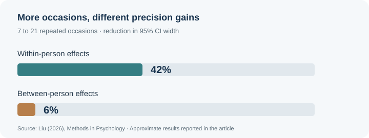
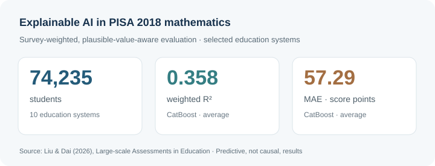

::: {.page-lede}
I develop quantitative methods for **Bayesian modeling and psychometrics**, especially when samples are small, responses are sparse, or study designs are complex. Questions from educational and social research motivate this work and help evaluate its practical value.
:::

## Research Program

01<strong>Bayesian & Longitudinal Methods</strong><small>Inference with limited information</small>
<ul><li>Variance prior specification</li><li>Prior calibration and translation</li><li>Random-effect covariance</li><li>Longitudinal and dyadic models</li></ul>

02<strong>Psychometrics & Measurement</strong><small>Reliable measurement under complexity</small>
<ul><li>Sparse ordinal CFA</li><li>Model-fit evaluation</li><li>IRT and item calibration</li><li>Measurement invariance and DIF</li></ul>

## Methodological Research

### Bayesian multilevel and longitudinal methods

My primary methodological line studies prior specification, calibration, random effects, and inference when higher-level information is limited. My dissertation, *Informative Variance Priors for Bayesian Multilevel Models*, developed this program through simulation and large-scale assessment applications. It now extends to prior translation across software, Bayesian multilevel item-response models, random-slope covariance structures, and longitudinal dyadic models.

<figure class="visual-science-figure"><svg viewBox="0 0 560 225" role="img" aria-label="Conceptual density curves illustrating priors with the same mode and different concentrations"><line x1="52" y1="184" x2="528" y2="184" stroke="currentColor" opacity=".55"/><line x1="52" y1="20" x2="52" y2="184" stroke="currentColor" opacity=".55"/><path d="M53 183 C100 182 158 135 213 95 C242 72 263 81 286 105 C340 158 406 181 525 183" fill="none" stroke="#4d82b0" stroke-width="3"/><path d="M53 184 C178 184 230 171 252 100 C263 60 275 60 286 100 C306 172 350 184 525 184" fill="none" stroke="#35927e" stroke-width="3"/><path d="M53 184 C235 184 253 177 266 67 C272 22 280 22 286 67 C299 177 317 184 525 184" fill="none" stroke="#b47d46" stroke-width="3"/><line x1="276" y1="25" x2="276" y2="184" stroke="currentColor" opacity=".3" stroke-dasharray="4 5"/><text x="290" y="31" fill="currentColor" font-size="13">Shared prior mode</text><text x="210" y="214" fill="currentColor" font-size="13">Variance component</text><text x="8" y="18" fill="currentColor" font-size="12">Density</text></svg><figcaption><strong>Prior calibration.</strong> Conceptual illustration of shared prior mode with different concentrations. Not empirical simulation results.</figcaption></figure>

::: {.research-links .compact-research-links}
[Variance priors in Bayesian multilevel models →](projects/bayesian-variance-priors.qmd)

[Selecting, translating, and reporting variance priors →](projects/bayesian-prior-guidance.qmd)

[Calibrating informative priors across models and software →](projects/bayesian-prior-calibration.qmd)

[Longitudinal dyadic modeling with limited numbers of dyads →](projects/dyadic-modeling.qmd)
:::

### Measurement, psychometrics, and SEM

A second methodological line examines what happens when measurement data are sparse, imbalanced, or heterogeneous across groups and contexts. I study fit-index behavior, category collapsing, condition-specific decision rules, item response theory, measurement invariance, differential item functioning, and assessment fairness.

ROC

<strong>Evaluating fit decisions under sparse ordinal responses</strong>
Two published studies examine how well fit indices detect misspecification (SEM) and how decision thresholds can be calibrated for specific data conditions (BRM). <a href="projects/sparse-ordinal-cfa.qmd">Explore both studies</a>.

::: {.research-links .compact-research-links}
[Sparse ordinal CFA and model-fit decisions →](projects/sparse-ordinal-cfa.qmd)
:::

## Published research in focus

<figure class="visual-evidence-card"><figcaption><strong>Longitudinal dyadic modeling.</strong> Repeated occasions improved precision differently for within-person and between-person effects in the examined simulation. <a href="projects/dyadic-modeling.qmd">Study details</a>.</figcaption></figure>
<figure class="visual-evidence-card"><figcaption><strong>Explainable AI for mathematics achievement.</strong> School-held-out predictions were evaluated with survey weights and ten plausible values. <a href="https://doi.org/10.1186/s40536-026-00320-y">Published study</a>.</figcaption></figure>

## Applied Research

My applied work uses quantitative methods to answer substantive questions while identifying design and measurement problems that motivate new methodological research.

::: {.applied-grid .research-applied-grid}
::: {.applied-card}

EDUCATION & ASSESSMENT

### Learning, measurement, and evaluation
Large-scale assessment, mathematics achievement, educational measurement, causal evaluation, and explainable machine learning in educational settings.
:::

::: {.applied-card}

SOCIAL RESEARCH & HUMAN TRAFFICKING

### Measurement, prevalence, and program evaluation
Survey design, prevalence estimation, latent-variable measurement, complex sampling, and program evaluation in research on child trafficking and related social outcomes.
:::

::: {.applied-card}

CROSS-CONTEXT QUANTITATIVE RESEARCH

### Measurement and design across settings
Cross-context measurement, respondent-driven and link-tracing sampling, measurement invariance, and reproducible workflows for interdisciplinary research.
:::
:::

## From Applied Problems to Methods

::: {.methods-origin-grid}
::: {.methods-origin-row}

Sparse ordinal data

→

Category collapsing and fit-index calibration

:::

::: {.methods-origin-row}

Limited higher-level samples

→

Informative variance priors and prior calibration

:::

::: {.methods-origin-row}

Few independent dyads

→

Estimand-information alignment and random-effect support

:::
:::

## Current & Emerging Work

::: {.current-work-callout}

NSF ECR:CORE LEVEL II · SUBAWARD PI · SUBMITTED

**Computational Experiences in Introductory Mathematics: A Longitudinal Study of Mathematical Agency and STEM Progression**

I lead the University of Georgia component and provide methodological leadership in measurement, psychometrics, and longitudinal modeling. The submitted UGA subaward request is **$250,000**.
:::

## Long-Term Agenda

My long-term program develops quantitative methods for settings where information is limited by small higher-level samples, sparse response patterns, or complex study designs. I aim to connect methodological development with applied research, reproducible tools, and graduate training.
